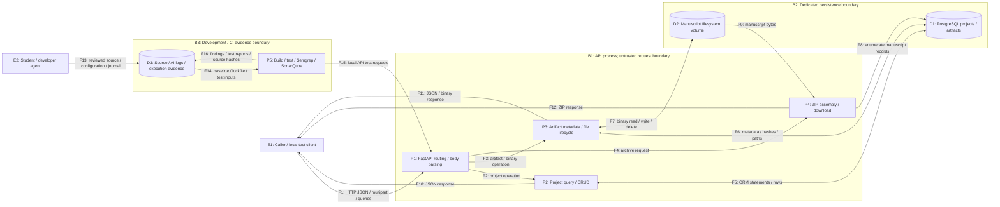
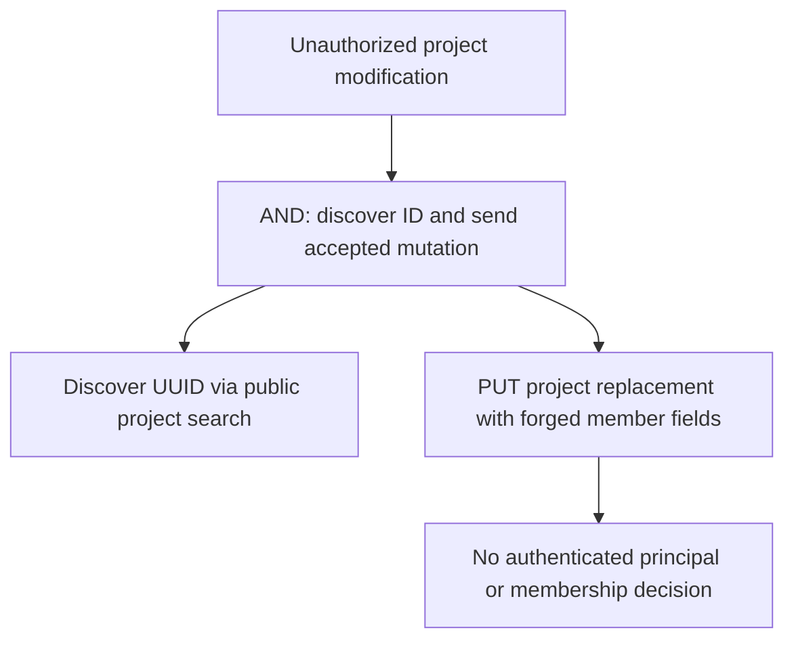
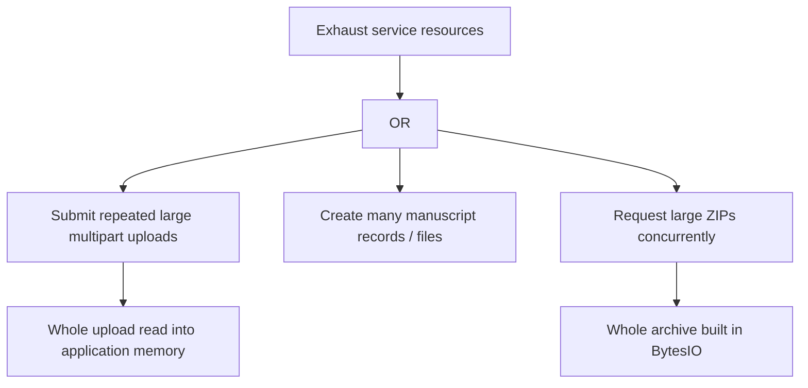
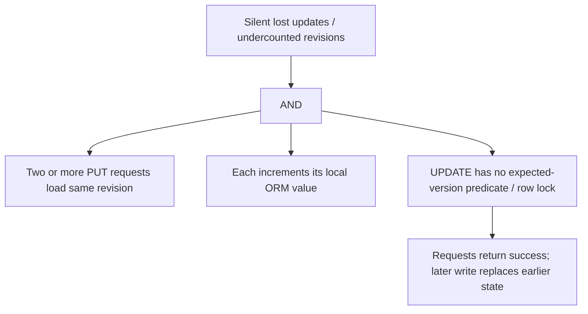

# AI Deliverable Metadata Block

- Authoring tool: OpenAI Codex desktop, local single-agent session, 2026-11-17 (IST).
- AI conceptual/prose contribution: 100% at initial creation; human refactoring: 0% at creation.
- Student verification and final contribution assessment: **pending**; review is not authorship.
- Prompts and output history: [.ai_logs/prompt-history.md](.ai_logs/prompt-history.md); [construction brief](.ai_logs/functional-brief.md).
- Native session export/share link: not supplied. Dated manual history is included; add the native export if available.

# Security analysis — Domain 1 functional baseline

## Scope and evidence

This analysis covers the generated PA2 source, its localhost Docker API, PostgreSQL, manuscript volume, and the development/evidence pipeline. The required standard blueprint is `support/ProjectPortalDomainServices.pdf`, pages 1–2. Security requirements below are the defensive baseline proposed for PA3, not claims that the PA2 functional specification already mandates each control. No peer service, live user data, or public target was tested. The independent mock issuer is a future PA3 aid outside the current runtime.

Evidence: `evidence/manual-validation.json`, both JUnit reports, Semgrep JSON/logs, Sonar exports, image metadata, and the source fingerprint. Confirmed weaknesses are V1–V3 in `sast-triage-report.md`; threats below include additional plausible scenarios that have not been exploited.

## Assets and trust assumptions

Assets: project ownership/member associations; project and artifact metadata; manuscript bytes/hash correspondence; revision history; service availability; database and volume state; source/lockfiles; scan reports and AI logs. Public repository URLs do not imply that every manuscript or write operation is public. A future policy should explicitly classify published metadata versus unpublished manuscripts and member information.

Callers and submitted fields are untrusted. PostgreSQL and the manuscript store are dedicated local service dependencies, but a compromised API can use its own credentials to reach them. UUID knowledge does not imply permission. The current request has no authenticated principal. CI dependencies and AI output require review. The student must replace the proposed policy with instructor clarifications if a conflicting official policy exists.

## Security requirements and acceptance criteria

| ID | Requirement for the hardened design | Proposed acceptance check |
| --- | --- | --- |
| SR1 | Authenticate every mutation with a locally verified JWT; fixed RS256/ES256 allowlist, trusted configured JWKS, required expiry/issuer/audience | Issuer's valid token passes; expired/wrong-key/wrong-audience/none/HS256/unknown-kid cases fail |
| SR2 | Enforce project membership/role authorization and derive identity from verified `sub`; protect member changes | Bob cannot alter Alice's project, membership, metadata or manuscript; only authorized faculty/admin can change privileged roles |
| SR3 | Define per-type schemas, bounded strings/collections and normalized timestamps; encode content at rendering sinks | Invalid URLs/durations/years and malformed member records are rejected without changing data |
| SR4 | Bound uploads, request bodies, list sizes, per-project quotas and concurrency; stream bounded ZIPs | Configured size/aggregate limits reject before storing excess data; pagination is bounded |
| SR5 | Make revision updates atomic; reject stale versions using conditional update/ETag | Two writes with the same expected revision cannot both silently succeed |
| SR6 | Keep database/file changes consistent, with staged files, atomic rename, reconciliation and rollback handling | Fault injection at write/commit/delete boundaries leaves metadata/hash and bytes consistent |
| SR7 | Protect confidential fields/data with a documented classification, retention, encryption and key-management plan | Keys remain outside source and backups; chosen PA3 sensitive field confirmed against official guidance before implementation |
| SR8 | Record attributable, bounded audit events for create/update/delete/download and authorization decisions | Events include verified actor, object, time, result and revision; exclude tokens/manuscript content |
| SR9 | Keep DB/volume access least-privileged; deploy with transport protection, non-root process and separated dependencies | Only intended API ingress exists; no public mock issuer/database; deployment configuration tested separately |
| SR10 | Bind scan and test evidence to source/image identity; protect build workflow and AI-log integrity | Source hash matches scan/release; provenance retained; no secrets in Git or log appendix |

## Data-flow diagram

Transport/database separation in Compose limits exposure but does not authenticate F1 or authorize F2–F4. F6 and F7 are separate operations, not one transaction. P4 buffers the ZIP in memory. P5 is outside the production application's runtime trust boundary. D3 represents files in the working repository, not an additional network service. Response arrows abstract the routing layer; they do not mean handlers open separate listening sockets.

## Attack-surface inventory

| Surface / verbs | Inputs and effects | Priority / threat |
| --- | --- | --- |
| `/api/v1/projects` POST | Project text, member/role and unit JSON; creates authoritative records | High: T1/T2/T3/T6 |
| `/api/v1/projects` GET | keyword, dept_id, lab_id, course_id, created_after/before, artifact_type; unpaginated list | High: T5/T6; wildcard broadening is not SQL injection |
| `/api/v1/projects/{project_id}` GET/PUT/DELETE | UUID selector, full replacement; revision and cascading deletion | High: T1/T3/T4/T7/T8 |
| `.../{project_id}/artifacts` GET | Whole artifact inventory | Medium: T5/T6 |
| `.../artifacts/{artifact_type}/` POST/GET | Type selector and arbitrary metadata dictionary | High: T2/T3/T5/T6 |
| `.../artifacts/{artifact_type}/{artifact_id}` GET/PUT/DELETE | Nested project/type/id check, metadata replacement/deletion | High: T1/T3/T8; parent check is present |
| `.../artifacts/manuscripts/{artifact_id}/file` POST/GET/DELETE | Multipart bytes/name, upload replacement, binary transfer | High: T3/T5/T6/T8 |
| `.../artifacts/manuscripts/download` GET | Aggregates all manuscript binaries into ZIP | High: T5/T6 |
| `/docs`, `/redoc`, `/openapi.json` GET | API discovery/schema rendering | Low alone; makes route discovery easier; no claim that documentation is inherently a vulnerability |
| `/healthz` GET | Liveness status only | Low; not a database-readiness guarantee |
| PostgreSQL ORM connection and dedicated volume | JSON/text records, server-generated file paths | High impact if API/service identity compromised; T7/T8/T9 |
| Manuscript filesystem and Docker mounts | Writes/deletes/downloads by service process | T5/T6/T8/T9; UUID paths and basename ZIP entries reduce traversal risk |
| Dependencies, Docker builds, CI actions, scanner rule downloads | Executable/tool supply chain | T11 |
| Source, prompt exports, journal and scan artifacts | Potential secrets, authorship and reproducibility evidence | T4/T10/T12 |

The API does not fetch submitted URLs, deserialize pickle, execute shell commands, or render manuscript text as HTML. SSRF, command injection, and stored XSS are therefore not confirmed findings in this version.

## Abuse cases and attack trees

### AC1: Modify another member's project (V1)

Precondition: attacker can reach the API and discover a project UUID. Goal: overwrite authoritative project/member information.

Observed: a fresh client with no Authorization header read and updated an Alice-associated fixture. Impact includes tampering and denial through deletion. SR1/SR2/SR8 mitigate this chain. Do not count authentication and missing role enforcement as two independent root causes solely to inflate the vulnerability count.

### AC2: Consume manuscript/ZIP resources (V2)

Precondition: ability to create project/artifact records or use an existing writable fixture. Goal: consume memory, disk or CPU.

Observed: a 4 MiB upload was accepted and stored; source has no application-level upload quota and reads the entire file. No OOM or system-wide exhaustion test was performed. Framework/proxy/body parsing limits may exist and must be distinguished from absent service policies. SR4, SR9 and monitoring mitigate this threat.

### AC3: Lose project revisions through competing updates (V3)

Precondition: multiple requests operate on the same project. Goal: cause accepted updates to overwrite each other or disguise the number of changes.

Observed: 12 concurrent successful HTTP updates advanced revision from 2 to 5 instead of 14. This is not only theoretical last-writer-wins behavior: the revision counter itself fails to represent successful writes. SR5 requires atomic version checking and a documented conflict response.

## STRIDE matrix for every DFD component

S = spoofing, T = tampering, R = repudiation, I = information disclosure, D = denial of service, E = elevation of privilege. For stores/entities, some categories concern their access interface rather than a store independently initiating an action. Each cell points to a threat/mitigation below; it is a scenario assessment, not six claimed exploits per component.

| Component | S | T | R | I | D | E |
| --- | --- | --- | --- | --- | --- | --- |
| E1 caller | T1 impersonation | T2 forged fields | T4 deny actions | T5 retrieve others' bytes | T6 repeat costly calls | T2 claim faculty role |
| P1 routing/parsing | T1 no principal | T2 malformed metadata | T4 no actor binding | T10 diagnostic errors | T6 unbounded requests | T3 no policy gate |
| P2 project CRUD/search | T1 anonymous mutation | T3/T7 writes/races | T4 no history | T5 broad search | T6 unpaginated reads | T2 membership replacement |
| P3 artifact/file handlers | T1 anonymous caller | T3/T8 replacement | T4 no file audit | T5 file reads | T6 upload pressure | T3 member checks absent |
| P4 ZIP/download | T1 no actor | T8 stale bytes/metadata | T4 no download audit | T5 aggregate disclosure | T6 memory/CPU | T3 aggregate permission absent |
| D1 PostgreSQL | T9 API DB identity misuse | T7/T8 inconsistent records | T4 overwritten revisions | T5/T9 readable records | T6 growth/query pressure | T9 excess DB rights |
| D2 manuscript store | T9 service identity misuse | T8 overwrite/delete | T4 no attributable history | T5/T9 volume disclosure | T6 disk growth | T9 filesystem permissions |
| E2 student/agent | T11 forged upstream/tool identity | T11 wrong generated edits | T12 missing provenance | T12 prompt secret leakage | T11 broken build | T11 unreviewed privileged command |
| P5 build/scanners | T11 dependency/action substitution | T11 artifact substitution | T12 incomplete telemetry | T12 secret-bearing logs | T11 unavailable registry/server | T11 runner permissions |
| D3 source/evidence/logs | T12 false author attribution | T11/T12 edited evidence | T12 untracked generation | T12 exposed keys/prompts | T12 missing/huge appendix | T11 workflow credentials |

## Threat register, mitigations and remaining risk

| Threat | Analysis / status | Proposed treatment |
| --- | --- | --- |
| T1 identity spoofing | V1 confirmed; no request principal | SR1: verified JWT identity; do not trust claimed member ID |
| T2 forged fields/roles | Schema permits arbitrary member dictionaries; privilege consequences arise once role policy exists | SR2/SR3: controlled member-management operation, explicit role enum, deny client-controlled privileged state |
| T3 unauthorized operations | V1 confirmed; nested object existence checks do not authorize callers | SR2: check policy on every route and every file/ZIP constituent |
| T4 repudiation/history | No attributable audit history and V3 undercounts revisions | SR5/SR8: versioned events, verified identity, append-only protected audit sink |
| T5 disclosure | Unauthenticated file/inventory access exists; confidentiality impact depends on publication policy | SR2/SR7: classify fields, scope read access, retention/encryption policy |
| T6 resource consumption | V2 source/bounded acceptance confirmed; exhaustion not attempted | SR4: request/upload/storage quotas, streamed bounded archives, pagination, timeouts and rate limits |
| T7 concurrent lost updates | V3 reproduced over HTTP | SR5: compare-and-swap version condition or row lock; 409/412 for stale clients |
| T8 file/DB inconsistency | File write/unlink precedes DB commit; crash/failure scenario not separately reproduced | SR6: staged file generation, atomic rename, transactional outbox/reconciliation, fault-injection verification |
| T9 excessive service/storage access | Container uses non-root and private DB network; public local-course password is fixture configuration, not a stolen secret | SR9: restrict DB role/mount permissions, production secret injection and backup controls |
| T10 diagnostic disclosure | Unexpected DB/file failures may produce logs; sensitive leakage not demonstrated | SR3/SR8: generic client errors, structured redacted internal logs, bounded event content |
| T11 supply-chain/build tampering | Dependencies/actions/rules are external tooling inputs; no compromise observed | SR10: locked dependencies, image/action pinning, protected reviews, least-privileged CI, source/report manifest |
| T12 evidence/AI-log integrity | Human reviews and journals remain pending; generated key/token inclusion would create avoidable exposure | SR10: honest dated logs, reviewer sign-off, scrub exports, ignore keys/tokens, verify immutable final history |

Proposed priority: V1 (high), V2 (medium/high availability risk with environmental dependence), V3 (medium integrity). These are contextual qualitative ratings, not invented CVSS vectors. Validate policy and deployment assumptions before assigning formal severity. Defense changes belong to PA3 after the baseline is preserved.

## Student review questions

Explain the SQL query construction and why it is parameterized despite f-string wildcard values. Trace a multipart upload from parser through bytes, volume, hash and DB commit. Explain why nested project/artifact checks do not establish ownership. Explain the 12-request lost-update result and the difference between atomic increment and optimistic conflict control. Identify which threats above are observed, source-supported, or still hypothetical.
