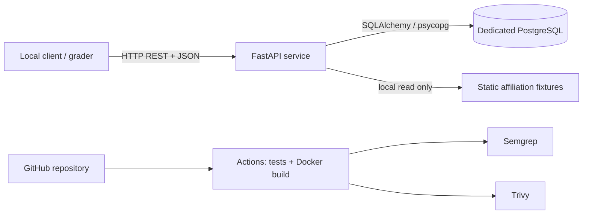
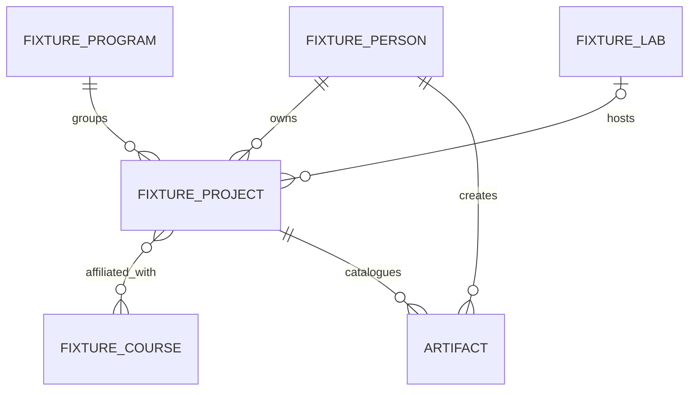

# AI Usage Log

Conceptual design and prose: 100% AI generated / 0% human refactored at initial creation. Agent: OpenAI Codex in the desktop app; configuration and observability limits are recorded in `Agent_environment.md`. Exact student design prompts: `docs/prompts.md`, P1-P3. This disclosure does not imply student review has occurred. Source: CS763 Project Description, Assignment 1 (pages 2-3), and domain overview (page 1), downloaded November 1, 2026.

# Project Artifact & Repository Indexer - Phase 1 proposal

Student: Atharva Nimbalkar. Domain: 1. This is the student's proposed specification, subject to the professor's standardized blueprint in Assignment 2. It is not a claim that these features are already implemented.

## 1. Purpose, boundary, and scope

Catalogue public Git repository profiles, academic manuscript documents, and video presentation metadata for academic projects. Filter artefacts by academic lab, department program, and course affiliation. Store records in this service's own PostgreSQL instance. References to people, projects, labs, programs, and courses are resolved solely against checked-in static mock fixtures; no calls to other student services, campus systems, GitHub, video sites, or identity providers occur at application runtime.

In scope for the proposed functional service: artefact metadata CRUD, list/filter/pagination, project affiliation lookup, and deterministic static reference data. Manuscripts are catalogued using a public document URL and metadata; the term document here denotes a catalogue entry, not a binary upload. This is a deliberate Phase 1 scope choice for the instructor to evaluate. If the master specification later requires binary storage, revise the boundary explicitly.

Out of scope: cloning/indexing repository source, downloading remote documents, fetching URL previews, file uploads, transcoding, grading, reviews, discussion, payment, team administration, search engines, frontend UI, cross-service integration, and production deployment.

**Week 1 implemented surface:** `/healthz`, `/readyz`, and generated FastAPI documentation only. No artefact CRUD, authentication, migrations, or DB business tables are implemented yet. Database connectivity is verified with `SELECT 1`. The full functional baseline belongs to Assignment 2; security remediation belongs to Assignment 3. No intentionally vulnerable code is introduced in week 1.

## 2. Technology and architecture

Python 3.13, FastAPI + Pydantic, Uvicorn, PostgreSQL 17; SQLAlchemy 2 with psycopg 3; Alembic for planned migrations. Docker multi-stage build, Compose for API + dedicated database; uv-managed lockfile; pytest/httpx and Ruff; GitHub Actions with Semgrep SAST and Trivy dependency/image scans. Exact resolved versions are in `uv.lock` and container digest pins in Docker/Compose/scanner scripts.



Infrastructure may fetch packages/images/vulnerability databases during build/scanning; those are tooling dependencies, not runtime domain integrations. API and PostgreSQL communicate on a project-specific internal Compose network. The API also joins a separate project-specific ingress bridge so Docker can publish its localhost port; PostgreSQL joins only the internal network. There are no shared DBs or other-service containers. The API's bridge is not a strict egress firewall; the runtime dependency boundary is enforced by the code having no external domain integrations.

## 3. Reference data contract

`fixtures/reference-data.json` contains fictional students, projects, programs, labs, and courses. IDs are stable UUIDs. A project has one owner, one program, an optional lab, and zero or more course IDs. This snapshot is authoritative for the proposal; reference entities have no public write API. On future startup, load and validate the snapshot locally. Artefact project and creator IDs must reference fixture entries. The creator must be the project's owner in this initial proposal. Two sample students own separate projects to support later ownership testing. Fixture URLs use reserved `example.org` domains; they are data only and are never fetched.

## 4. REST contract (planned, unless marked week 1)

Base prefix for business endpoints: `/api/v1`. JSON UTF-8. All IDs are UUID strings. Timestamps are server-generated UTC ISO 8601 strings with a `Z` suffix. No request body is accepted for GET or DELETE.

| Method | Route | Request | Success | Failure |
| --- | --- | --- | --- | --- |
| GET | `/healthz` (week 1) | none | 200 `{"status":"ok","service":"artifact-indexer","phase":"week-1"}` | 500 on unexpected app failure |
| GET | `/readyz` (week 1) | none | 200 `{"status":"ready","database":"reachable"}` after `SELECT 1` | 503 `{"detail":"Database unavailable"}` on DB errors |
| GET | `/api/v1/reference-data` | none | 200 static fixture snapshot | 500 for invalid local fixture |
| GET | `/api/v1/projects` | `owner_id?`, `program_id?`, `lab_id?`, `course_id?`, `limit`, `offset` | 200 project list envelope | 422 malformed query |
| POST | `/api/v1/artifacts` | `ArtifactCreate` | 201 `ArtifactRead`, Location header | 404 unknown project, 409 duplicate URL within project, 422 invalid fields/reference/type |
| GET | `/api/v1/artifacts` | filters below | 200 artefact list envelope | 422 invalid filters/pagination |
| GET | `/api/v1/artifacts/{artifact_id}` | UUID | 200 `ArtifactRead` | 404 absent, 422 malformed UUID |
| PATCH | `/api/v1/artifacts/{artifact_id}` | `ArtifactUpdate` | 200 complete updated `ArtifactRead` | 404 absent, 409 duplicate, 422 invalid payload |
| DELETE | `/api/v1/artifacts/{artifact_id}` | UUID | 204 empty body | 404 absent, 422 malformed UUID |

List filters: `project_id`, `creator_id`, `kind`, `program_id`, `lab_id`, `course_id`. Filters combine with AND; `kind` is one of `repository`, `manuscript`, `video`. Known-format IDs without matches return an empty list. Default `limit=20`, range 1-100; default `offset=0`, minimum 0. Order is `created_at DESC, id ASC`, stable for a fixed dataset. Affiliation filters resolve through fixture projects, not arbitrary user-provided affiliation strings. Return `{"items":[],"total":0,"limit":20,"offset":0}`; total is the number matching filters before pagination.

Error body: `{"detail":"message"}` for domain errors. FastAPI/Pydantic's documented 422 validation envelope is used for malformed fields. Internal details, SQL, DSNs, credentials, and stack traces never belong in HTTP responses. Production error/auth policies will be revisited in the standardized/security phases.

## 5. Payload schemas

All object schemas reject unknown fields. All business schemas below are design contracts, not week-one Pydantic code. A non-empty string must contain a non-whitespace character; trim surrounding whitespace on textual metadata. Optional strings can be null. Identifiers and server-managed fields cannot be overwritten.

`ArtifactCreate`:

| Field | JSON type | Required | Constraints |
| --- | --- | --- | --- |
| project_id | string UUID | yes | must exist in project fixture |
| creator_id | string UUID | yes | must equal the project's owner fixture ID |
| kind | string enum | yes | repository / manuscript / video |
| title | string | yes | 1-200 characters |
| description | string or null | no | up to 2,000 characters; default null |
| url | string URI | yes | absolute HTTPS URL, max 2,048 chars, no username/password component |
| metadata | object | yes | one of the kind-specific objects below |

Type-specific `metadata` (reject fields from other kinds):

| kind | Fields |
| --- | --- |
| repository | `provider`: enum github/gitlab/other, required; `default_branch`: non-empty string <=100, default main; `primary_language`: nullable non-empty string <=50, default null |
| manuscript | `authors`: array of 1-20 non-empty strings <=100 each, required; `publication_year`: nullable integer 1900-2100, default null; `document_format`: enum pdf/docx/other, required |
| video | `duration_seconds`: integer 1-86400, required; `presenter`: non-empty string <=100, required; `recorded_on`: nullable ISO date YYYY-MM-DD, default null |

Uniqueness: `(project_id, url)` exact match after trimming the URL. Do not strip URL paths or query parameters; the proposal deliberately does not infer URL equivalence. URLs are never dereferenced.

`ArtifactUpdate`: non-empty object with any subset of `title`, `description`, `url`, `metadata`. Only `description` may explicitly be null. Omitted fields stay unchanged. `metadata`, when supplied, replaces the entire metadata object and must satisfy the stored kind's schema. `kind`, `project_id`, and `creator_id` are immutable; attempts return 422. PATCH validates the merged record before committing atomically.

`ArtifactRead`: all create fields plus `id` (UUID), `created_at`, `updated_at` (UTC timestamps); nullable/default fields are always present. No secrets or internal database fields are returned.

Example create:

```json
{
  "project_id": "20000000-0000-4000-8000-000000000001",
  "creator_id": "10000000-0000-4000-8000-000000000001",
  "kind": "repository",
  "title": "Campus energy dashboard",
  "description": "Fictional course project repository profile.",
  "url": "https://example.org/repos/energy-dashboard",
  "metadata": {"provider": "other", "default_branch": "main", "primary_language": "Python"}
}
```

Example response adds `id: "60000000-0000-4000-8000-000000000001"`, `created_at: "2026-11-01T12:00:00Z"`, and `updated_at: "2026-11-01T12:00:00Z"`. These values are illustrative, not claimed execution results.

## 6. Planned database model and relationships

Only artefact records are persisted as business data. Reference entities remain local fixture records. Because fixture IDs are not SQL rows, their validation is an application constraint, not a PostgreSQL foreign key.

| Table: artifacts | PostgreSQL type | Constraints |
| --- | --- | --- |
| id | UUID | primary key, generated UUID4 |
| project_id | UUID | not null, indexed, application reference to fixture project |
| creator_id | UUID | not null, indexed, application reference to fixture person |
| kind | VARCHAR(16) | not null, CHECK in repository/manuscript/video |
| title | VARCHAR(200) | not null |
| description | TEXT | nullable, application length bound |
| url | VARCHAR(2048) | not null, UNIQUE(project_id, url) |
| metadata | JSONB | not null, kind-specific schema validated in application |
| created_at | TIMESTAMPTZ | not null, server default now() |
| updated_at | TIMESTAMPTZ | not null, initialized on create, updated by service on patch |

Composite index `(created_at DESC, id ASC)` supports deterministic lists; `(project_id, kind)` supports common filters. Catch duplicate constraint violations and roll back the transaction before returning 409. SQLAlchemy's Python attribute for the JSONB column will be `artifact_metadata` to avoid its reserved `metadata` attribute; API serialization still uses `metadata`. Alembic will own migrations in Assignment 2, after the master blueprint arrives.



The diagram shows logical relationships. Only ARTIFACT maps to a planned database table; fixture relationships are not SQL joins/foreign keys.

## 7. Planned acceptance criteria

1. Create one record of each artefact kind and retrieve unchanged metadata after API restart using persistent DB storage.
2. Filter by each affiliation and combined kind/project; confirm totals, pagination and stable ordering.
3. Patch description and kind-appropriate metadata; verify immutable fields are rejected and timestamps advance.
4. Delete a record; subsequent fetch/delete returns 404.
5. Reject malformed IDs, incompatible metadata, blank title, unknown fields, unknown project/creator references and duplicate project URL with the documented status.
6. Verify no network fetch occurs for any submitted URL and no connection to other student services exists.
7. Week 1 only: health succeeds; readiness succeeds with local PostgreSQL and returns a generic 503 when it is unavailable. Compose builds and runs; CI captures successful scans even when findings are present.

## 8. Pipeline behavior and evidence

On pushes, pull requests and manual dispatch: run lint/tests, build Docker, start isolated Compose stack, poll health/readiness, run Semgrep on Python sources, run Trivy against the lockfile and built image, upload JSON reports and logs. Vulnerability findings are intentionally non-blocking for research telemetry. Scanner execution failures, missing/invalid reports, failed builds and failed tests must fail the workflow. No `continue-on-error` masks tool failures. This distinction preserves usable baseline data.

## 9. Later-phase considerations

Assignment 2 must follow the professor's master requirements and preserve an unmodified functional baseline with its prompts and tests. Assignment 3 will design decentralized JWT asymmetric signature verification and row-level authorization, plus other mitigations supported by actual findings. Fixture `creator_id` is a functional reference in this proposal, not an authentication mechanism. Never present the week-one skeleton as an authenticated production service. Assignment 4 runs isolated naive/secure versions for comparative DAST, a final report and live demonstration.
